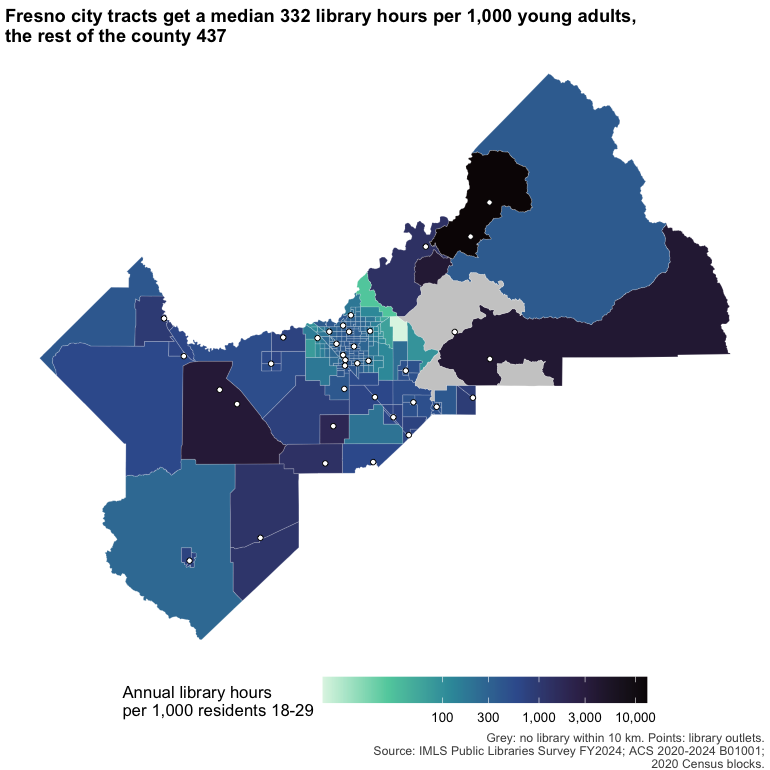
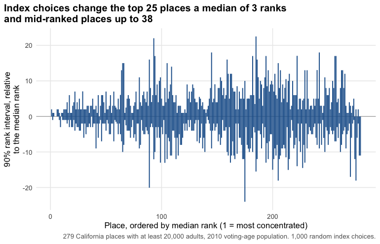
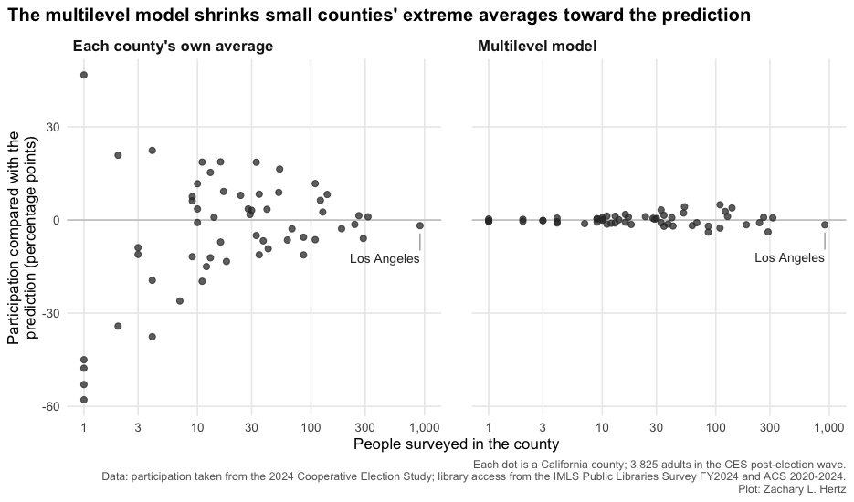
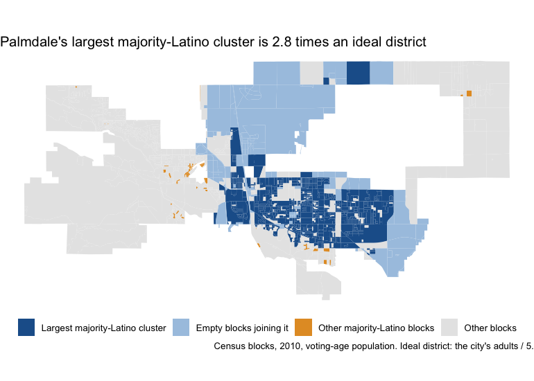

<!-- README.md is generated from README.Rmd. Please edit that file. -->

# placeindex

<!-- badges: start -->

[](https://github.com/zacharylhertz/placeindex/actions/workflows/R-CMD-check.yaml) <!-- badges: end -->

placeindex is a package to build measures and composite indices using census tracts and public data, and to check the indices against survey data. To this end, there are several functions. The `acc_` functions calculate access: how easily people can reach various things that are in limited supply, such as public library access, borrowing from the enhanced two-step floating catchment area (E2SFCA) method to account for both access and collective use. The `idx_` functions produce an index: they normalize indicators and combine them into an index, as well as provide information about how judgements about a place’s rank using the index depend on the normalization, weights and aggregation rules used when deriving the index. The `val_` functions serve as validation: to allow for comparison to survey data, they aggregate tract scores up to the geography in question, and flag places where the survey data differs from the index-based prediction. The `seg_` functions measure segregation: they assign census blocks to places and use standard measures to show how concentrated a particular group is within a place. For illustrative purposes, the package includes an example dataset, `ca_place_concentration`, which includes measures of Latino concentration for every California place in 2010 and 2020.

## Installation

``` r
# install.packages("remotes")
remotes::install_github("zacharylhertz/placeindex")
```

## Worked examples

There are three vignettes using the package and California data:

- `vignette("library-access")` creates a library access score for residents 18-29 in every California Census tract, including uncertainty intervals.
- `vignette("validation-mlm")` asks whether people with more library access participate more in politics, and tests whether that relationship differs by religious attendance. It reports the smallest detectable effect and ranks counties by how much they differ from a modeled prediction.
- `vignette("cvra-concentration")` asks whether Latino residents in five California cities are sufficiently concentrated to form a potential majority in a city council district, and builds a composite index of concentration.

## Functions

| Family | Function | Returns |
|----|----|----|
| `acc_` | `acc_centroids()` | Population-weighted centroids of larger units (sf points) |
|  | `acc_cost_matrix()` | Origin-to-site costs, straight-line or supplied travel times (tibble) |
|  | `acc_e2sfca()` | Enhanced two-step floating catchment area access per origin (tibble) |
| `idx_` | `idx_normalize()` | Indicators rescaled by z-score, min-max or rank (the input data, columns replaced) |
|  | `idx_combine()` | Weighted arithmetic or geometric mean of indicators (the input data, plus an index column) |
|  | `idx_sensitivity()` | Median rank and 90% rank interval across random constructions (tibble) |
| `val_` | `val_aggregate()` | Weighted mean of unit scores within larger units, with total weight and unit count (tibble) |
|  | `val_group_effects()` | Shrunken random intercepts from an lme4 model, with conditional SEs, intervals and flags (tibble) |
| `seg_` | `seg_blocks()` | Census blocks with group and total counts and a place ID (sf) |
|  | `seg_measures()` | Share, dissimilarity, isolation, exposure and majority-block share per place (tibble) |
|  | `seg_clusters()` | Contiguous majority-group clusters per place, measured against ideal district size (tibble) |
|  | `seg_cluster_blocks()` | Each block labeled with its cluster, for mapping (sf) |

## Examples

``` r
library(placeindex)
library(dplyr)
library(ggplot2)
```

### Spatial access

`acc_e2sfca()` takes a two-step approach. First, we want to measure how much demand a library has. For each library, it divides the library’s hours by the number of people who live within reach of the libary and weights people relative to their distance from the library. Second, we want to measure how well-served a tract is. For each tract, the function adds up shares for each library within reach: taking the library’s hours per person, weighted by distance. Here is a small example with three tracts and two libraries:

``` r
tracts <- data.frame(tract = c("a", "b", "c"), youth = c(100, 200, 300))
libraries <- data.frame(outlet = c("x", "y"), hours = c(10, 30))
cost <- data.frame(
  from = c("a", "a", "b", "b", "c", "c"),
  to = c("x", "y", "x", "y", "x", "y"),
  cost = c(0, 20, 8, 4, 15, 0)
)
acc_e2sfca(tracts, libraries, cost, tract, youth, outlet, hours, catchment = 10)
#> # A tibble: 3 × 3
#>   tract access n_sites
#>   <chr>  <dbl>   <int>
#> 1 a     0.0622       1
#> 2 b     0.0713       2
#> 3 c     0.0651       1
```

Here, we hand-set distances. With real data, `acc_centroids()` calculates centroids, the population-weighted center of each tract’s blocks, and then `acc_cost_matrix()` calculates the relevant distances. In the code below, `blocks` holds block points with `tract` and `pop` columns, `youth_counts` holds each tract’s `youth` count, and `outlets` holds library points with `outlet` and `hours` columns, all in a projected coordinate system measured in meters:

``` r
origins <- acc_centroids(blocks, tract, pop) |>
  left_join(youth_counts, by = "tract", relationship = "one-to-one")
costs <- acc_cost_matrix(origins, outlets, tract, outlet, max_cost = 10000)
access <- acc_e2sfca(origins, outlets, costs, tract, youth, outlet, hours,
                     catchment = 10000)
```

The library vignette runs this for every California tract, with annual library hours as capacity and residents aged 18 to 29 as demand, and gives each score an interval based on the ACS margins of error. The map shows Fresno County:



### Composite indices

`idx_normalize()` and `idx_combine()` build an index from any set of indicators. This example combines three of the concentration measures in `ca_place_concentration` (described under Residential concentration below) for California places with at least 100,000 adults in 2020:

``` r
ca_place_concentration |>
  filter(year == 2020, universe == "vap", pop_total >= 100000) |>
  idx_normalize(c(isolation, majority_share, largest_ratio), method = "rank") |>
  idx_combine(c(isolation, majority_share, largest_ratio), name = "index") |>
  arrange(desc(index)) |>
  select(place_name, index) |>
  head(5)
#> # A tibble: 5 × 2
#>   place_name                 index
#>   <chr>                      <dbl>
#> 1 Salinas city, California   0.993
#> 2 Santa Ana city, California 0.986
#> 3 Oxnard city, California    0.958
#> 4 Pomona city, California    0.931
#> 5 Ontario city, California   0.917
```

`idx_sensitivity()` rebuilds the index many times, drawing the normalization, weights and aggregation rule at random each time, and reports each unit’s median rank with a 90% interval. To demonstrate, this example uses the 279 places with at least 20,000 adults in 2010:

``` r
indicators <- c("isolation", "majority_share", "largest_ratio")
large_places <- ca_place_concentration |>
  filter(year == 2010, universe == "vap", pop_total >= 20000)

ranks <- idx_sensitivity(large_places, cols = all_of(indicators),
                         id = place_geoid, n_sims = 1000, seed = 2010) |>
  arrange(median_rank) |>
  mutate(order = row_number())

ggplot(ranks, aes(x = order)) +
  geom_hline(yintercept = 0, color = "gray60", linewidth = 0.3) +
  geom_linerange(aes(ymin = rank_lower - median_rank,
                     ymax = rank_upper - median_rank),
                 color = "#1f5f99", linewidth = 0.6) +
  labs(
    title = paste("Index choices change the top 25 places a median of 3 ranks",
                  "and mid-ranked places up to 38", sep = "\n"),
    x = "Place, ordered by median rank (1 = most concentrated)",
    y = "90% rank interval, relative\nto the median rank",
    caption = paste("279 California places with at least 20,000 adults,",
                    "2010 voting-age population. 1,000 random index choices.")
  ) +
  theme_minimal(base_size = 11) +
  theme(
    panel.grid.minor = element_blank(),
    plot.title = element_text(face = "bold"),
    plot.title.position = "plot",
    plot.caption = element_text(hjust = 1, color = "gray40")
  )
```



### Validation with survey data

`val_aggregate()` averages tract scores up to a particular geography, such as counties, by weighting each tract by population to allow for validation with survey data. After fitting a multilevel model, `val_group_effects()` states the distance between groups’ outcomes and the model’s prediction, including a standard error and a 90 percent confidence interval. In the vignette these groups are counties. Here is a small example with lme4’s `sleepstudy` data:

``` r
fit <- lme4::lmer(Reaction ~ Days + (1 | Subject), data = lme4::sleepstudy)
val_group_effects(fit, Subject) |> head(3)
#> # A tibble: 3 × 7
#>   Subject estimate std_error lower upper     n excludes_zero
#>   <chr>      <dbl>     <dbl> <dbl> <dbl> <int> <lgl>        
#> 1 337         72.2      9.48  56.6  87.8    10 TRUE         
#> 2 308         40.8      9.48  25.2  56.4    10 TRUE         
#> 3 352         36.4      9.48  20.8  52.0    10 TRUE
```

The validation vignette links California respondents in the 2024 Cooperative Election Study (CES) to their county’s library access score and models their political and civic participation. The vignette tests whether the relationship between library access and participation is moderated by religious attendance, as a measure of social civic participation. The model fits a statewide line allowing county intercepts to differ. Because some counties may have small-n and high variance, the model shrinks those counties’ intercepts toward the statewide estimate. This should be read as a demonstration. The left panel shows each county’s own average, and the right panel shows the model’s estimates:



### Residential concentration

`seg_blocks()` downloads decennial census block counts with tidycensus, assigns each block to its place using the Census Bureau’s Block Assignment File, and attaches block boundaries from tigris. It needs a Census API key. `seg_measures()` and `seg_clusters()` then work on any table of blocks:

``` r
blocks <- seg_blocks("CA", 2010, universe = "vap", county = "Los Angeles")
seg_measures(blocks, by = place_geoid, group = latino, total = total)
seg_clusters(blocks, by = place_geoid, group = latino, total = total,
             n_districts = 5)
```

`seg_clusters()` joins adjacent majority-Latino blocks into clusters and compares the population of the largest cluster with that of an ideal district, which is the place’s population divided by the number of districts. If there are at least as many residents in the largest cluster as an ideal district, then you should be able to draw a majority-Latino district inside it. Empty blocks can be used to bridge clusters, because they have a population of zero, by default. To treat these as gaps instead, set `bridge_empty = FALSE`. The map shows the clusters in Palmdale in 2010:



`ca_place_concentration` has these measures for every California place. Here are the five cities from the CVRA vignette, using 2010 voting-age population:

``` r
ca_place_concentration |>
  filter(
    year == 2010, universe == "vap",
    place_name %in% paste(c("Palmdale", "West Covina", "Victorville",
                            "Anaheim", "Modesto"), "city, California")
  ) |>
  transmute(
    city = sub(" city, California", "", place_name),
    group_share, dissimilarity, isolation, largest_ratio, n_districts_floor
  )
#> # A tibble: 5 × 6
#>   city        group_share dissimilarity isolation largest_ratio n_districts_floor
#>   <chr>             <dbl>         <dbl>     <dbl>         <dbl>             <dbl>
#> 1 Anaheim           0.470         0.452     0.619         1.78                  1
#> 2 Modesto           0.304         0.339     0.422         0.326                 0
#> 3 Palmdale          0.501         0.305     0.569         2.84                  2
#> 4 Victorville       0.435         0.211     0.478         0.993                 0
#> 5 West Covina       0.486         0.260     0.539         2.02                  2
```

## Data

`ca_place_concentration` covers every incorporated place and census designated place in California, for both total and voting-age population:

``` r
count(ca_place_concentration, year, universe, name = "places")
#> # A tibble: 4 × 3
#>    year universe places
#>   <int> <chr>     <int>
#> 1  2010 total      1523
#> 2  2010 vap        1523
#> 3  2020 total      1611
#> 4  2020 vap        1611
```

Summed block counts match the Census Bureau’s published place totals in all 6,268 combinations of place, year and population universe (total or voting-age), for both the total and the Hispanic or Latino count. You can find a comparison between these in `data-raw/ca_place_validation.csv`.

## Licensing and data sources

This package is under the MIT license. Census and ACS data are taken from the public U.S. Census Bureau sources. Library data is taken from the Institute of Museum and Library Services Public Libraries Survey (FY2024). The validation vignette is based on use of a local copy of the 2024 Cooperative Election Study Common Content, but does not include that data in the package; it can be downloaded from Dataverse.
