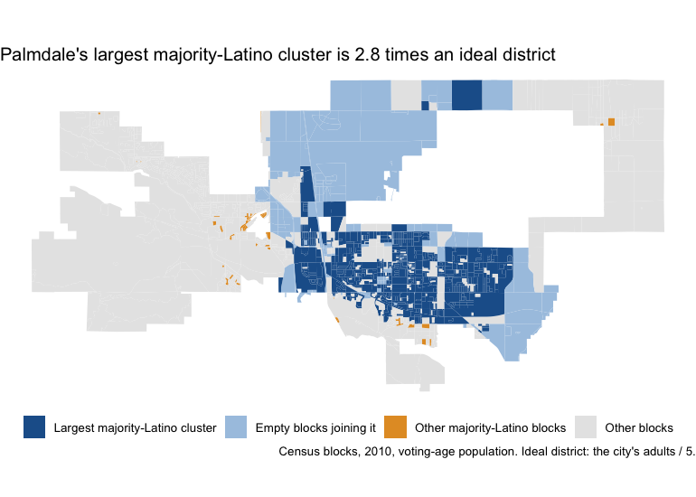

<!-- cvra-concentration.Rmd is generated from cvra-concentration.Rmd.orig
by vignettes/precompute.R, which needs the network and a Census API key.
Edit the .orig file, not the .Rmd. -->


Under the California Voting Rights Act, cities switched from at-large to
district elections for their councils. A switch can only help Latino
candidates where Latinos live close enough together to form a majority in a
district. This vignette measures that concentration for five cities with
2010 census blocks.

The measures use the voting-age population (VAP). Courts look at citizen
voting-age population, which the Census Bureau does not publish for blocks,
so VAP is the closest block-level count.


``` r
library(placeindex)
library(dplyr)
library(ggplot2)
options(tigris_use_cache = TRUE)
```

## Blocks

The package dataset `ca_place_concentration` lists every California place,
so it gives the five cities' place codes.


``` r
cities <- paste(c("Palmdale", "West Covina", "Victorville", "Anaheim",
                  "Modesto"), "city, California")
places <- ca_place_concentration |>
  filter(year == 2010, universe == "vap", place_name %in% cities) |>
  transmute(place_geoid, city = sub(" city, California", "", place_name))
places
#> # A tibble: 5 × 2
#>   place_geoid city       
#>   <chr>       <chr>      
#> 1 0602000     Anaheim    
#> 2 0648354     Modesto    
#> 3 0655156     Palmdale   
#> 4 0682590     Victorville
#> 5 0684200     West Covina
```

`seg_blocks()` downloads block counts and polygons for the four counties the
cities lie in and assigns each block to its place.


``` r
blocks <- seg_blocks(
  "CA", 2010, universe = "vap",
  county = c("Los Angeles", "San Bernardino", "Orange", "Stanislaus")
) |>
  filter(place_geoid %in% places$place_geoid)
nrow(blocks)
#> [1] 10685
```

## How concentrated are Latinos?

`seg_measures()` gives the Latino share, two standard segregation measures
(dissimilarity and isolation) and the share of Latinos who live in
majority-Latino blocks for each city. It also returns exposure, which for
two groups is 1 minus isolation, so the table leaves it out.


``` r
measures <- seg_measures(blocks, by = place_geoid, group = latino,
                         total = total)
measures |>
  left_join(places, by = "place_geoid", relationship = "one-to-one") |>
  select(city, pop_total, group_share, dissimilarity, isolation,
         majority_share)
#> # A tibble: 5 × 6
#>   city        pop_total group_share dissimilarity isolation majority_share
#>   <chr>           <dbl>       <dbl>         <dbl>     <dbl>          <dbl>
#> 1 Palmdale       102236       0.501         0.305     0.569          0.732
#> 2 West Covina     80023       0.486         0.260     0.539          0.620
#> 3 Victorville     77880       0.435         0.211     0.478          0.374
#> 4 Anaheim        244348       0.470         0.452     0.619          0.660
#> 5 Modesto        147153       0.304         0.339     0.422          0.323
```

`seg_clusters()` finds contiguous clusters of majority-Latino blocks and
compares the largest with an ideal district for a five-district council.
`largest_ratio` above 1 means the largest cluster alone could hold a
majority-Latino district. `n_districts_floor` adds up the whole districts
every cluster could hold; it is a rough guide, not a bound.


``` r
clusters <- seg_clusters(blocks, by = place_geoid, group = latino,
                         total = total, n_districts = 5)
clusters |>
  left_join(places, by = "place_geoid", relationship = "one-to-one") |>
  select(city, n_clusters, largest_pop, largest_share, largest_ratio,
         n_viable, n_districts_floor)
#> # A tibble: 5 × 7
#>   city        n_clusters largest_pop largest_share largest_ratio n_viable n_districts_floor
#>   <chr>            <int>       <dbl>         <dbl>         <dbl>    <int>             <dbl>
#> 1 Anaheim             70       86878         0.756         1.78         1                 1
#> 2 Modesto             40        9603         0.692         0.326        0                 0
#> 3 Palmdale            29       58141         0.633         2.84         1                 2
#> 4 Victorville         70       15465         0.615         0.993        0                 0
#> 5 West Covina         35       32275         0.618         2.02         1                 2
```

By default, blocks with no residents can join two clusters, because a
district can include them at no cost in population. Leaving them out is a
robustness check:


``` r
seg_clusters(blocks, by = place_geoid, group = latino, total = total,
             n_districts = 5, bridge_empty = FALSE) |>
  left_join(places, by = "place_geoid", relationship = "one-to-one") |>
  select(city, largest_ratio, n_viable, n_districts_floor)
#> # A tibble: 5 × 4
#>   city        largest_ratio n_viable n_districts_floor
#>   <chr>               <dbl>    <int>             <dbl>
#> 1 Anaheim             0.971        0                 0
#> 2 Modesto             0.283        0                 0
#> 3 Palmdale            2.47         1                 2
#> 4 Victorville         0.197        0                 0
#> 5 West Covina         0.436        0                 0
```

## A concentration index

To rank the cities against the rest of the state, the next step uses
`ca_place_concentration`, which holds the same measures for every place.
It keeps places with at least 20,000 adults in 2010 and combines three
indicators that rise as Latinos become easier to place in majority
districts: isolation, the share in majority-Latino blocks, and the largest
cluster relative to an ideal district.


``` r
indicators <- c("isolation", "majority_share", "largest_ratio")
large_places <- ca_place_concentration |>
  filter(year == 2010, universe == "vap", pop_total >= 20000)
nrow(large_places)
#> [1] 279

index <- large_places |>
  idx_normalize(all_of(indicators), method = "rank") |>
  idx_combine(all_of(indicators), name = "concentration") |>
  mutate(rank = rank(-concentration, ties.method = "min"))
index |>
  inner_join(places, by = "place_geoid", relationship = "one-to-one") |>
  select(city, all_of(indicators), concentration, rank)
#> # A tibble: 5 × 6
#>   city        isolation majority_share largest_ratio concentration  rank
#>   <chr>           <dbl>          <dbl>         <dbl>         <dbl> <int>
#> 1 Anaheim         0.802          0.788         0.781         0.790    58
#> 2 Modesto         0.547          0.536         0.496         0.526   133
#> 3 Palmdale        0.777          0.827         0.845         0.817    52
#> 4 Victorville     0.619          0.572         0.669         0.620   108
#> 5 West Covina     0.730          0.770         0.799         0.766    65
```

The ranks depend on choices: how to normalize, how to weight, and whether
to average arithmetically or geometrically. `idx_sensitivity()` redraws
those choices many times and reports each place's median rank with a 90%
interval.


``` r
sensitivity <- idx_sensitivity(
  large_places,
  cols = all_of(indicators),
  id = place_geoid,
  n_sims = 1000,
  seed = 2010
)
sensitivity |>
  inner_join(places, by = "place_geoid", relationship = "one-to-one") |>
  select(city, median_rank, rank_lower, rank_upper)
#> # A tibble: 5 × 4
#>   city        median_rank rank_lower rank_upper
#>   <chr>             <dbl>      <dbl>      <dbl>
#> 1 Anaheim              58         57       61  
#> 2 Modesto             135        129      140  
#> 3 Palmdale             49         45       56  
#> 4 Victorville         108         97      117  
#> 5 West Covina          63         58       69.0
```

## Map: Palmdale

`seg_cluster_blocks()` labels each block with its cluster, which shows where
the largest cluster lies.


``` r
palmdale_id <- places$place_geoid[places$city == "Palmdale"]
palmdale <- blocks |>
  filter(place_geoid == palmdale_id) |>
  seg_cluster_blocks(by = place_geoid, group = latino, total = total) |>
  mutate(type = case_when(
    cluster %in% 1 & total > 0 ~ "Largest majority-Latino cluster",
    cluster %in% 1 ~ "Empty blocks joining it",
    total > 0 & latino > 0.5 * total ~ "Other majority-Latino blocks",
    .default = "Other blocks"
  ))
ratio <- clusters$largest_ratio[clusters$place_geoid == palmdale_id]

ggplot(palmdale) +
  geom_sf(aes(fill = type), color = NA) +
  scale_fill_manual(
    values = c("Largest majority-Latino cluster" = "#1f5f99",
               "Empty blocks joining it" = "#a9c6e2",
               "Other majority-Latino blocks" = "#e39b2d",
               "Other blocks" = "#e6e6e6"),
    breaks = c("Largest majority-Latino cluster", "Empty blocks joining it",
               "Other majority-Latino blocks", "Other blocks"),
    name = NULL
  ) +
  labs(
    title = sprintf(
      "Palmdale's largest majority-Latino cluster is %.1f times an ideal district",
      ratio
    ),
    caption = paste("Census blocks, 2010, voting-age population.",
                    "Ideal district: the city's adults / 5.")
  ) +
  theme_void() +
  theme(legend.position = "bottom", plot.title.position = "plot")
```


