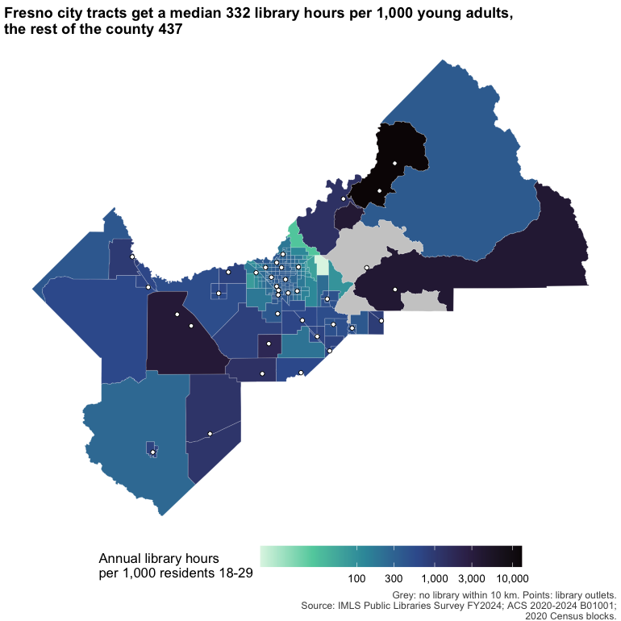

<!-- library-access.Rmd is generated from library-access.Rmd.orig by
vignettes/precompute.R, which needs the network and a Census API key.
Edit the .orig file, not the .Rmd. -->


A public library is one of the few civic institutions open to anyone,
without a fee or a membership. This vignette scores every California census
tract on how easily its residents aged 18 to 29 can reach one. It uses the
enhanced two-step floating catchment area method (E2SFCA), which credits a
tract with the capacity of nearby libraries but divides that capacity among
everyone else nearby who could use it. It then carries the sampling error in
the American Community Survey (ACS) youth counts through to an interval for
each tract's score.


``` r
library(placeindex)
library(dplyr)
library(ggplot2)
library(sf)
options(tigris_use_cache = TRUE)
```

## Supply: library outlets

The Institute of Museum and Library Services (IMLS) Public Libraries Survey
lists every public library outlet with its coordinates. Fiscal year 2024 is
the latest release.


``` r
pls_url <- "https://www.imls.gov/sites/default/files/2026-06/pls_fy2024_csv.zip"
pls_zip <- file.path(tempdir(), basename(pls_url))
download.file(pls_url, pls_zip, mode = "wb", quiet = TRUE)
outlets <- read.csv(unz(pls_zip, "CSV/pls_fy24_outlet_pud24i.csv"))
ca_outlets <- filter(outlets, STABR == "CA")
count(ca_outlets, C_OUT_TY)
#>   C_OUT_TY   n
#> 1       BR 971
#> 2       BS  65
#> 3       CE 200
```

`C_OUT_TY` separates central libraries (CE) and branches (BR) from
bookmobiles (BS). Bookmobiles are dropped, because their coordinates mark a
home base rather than the places they stop.

Capacity is each outlet's annual public service hours (`HOURS`). Hours
measure when a young adult can actually walk in, which matters for people
who work or study during the day. The alternative, floor area (`SQ_FEET`),
is badly skewed: among fixed outlets with positive values the largest
reports 538,802 square feet against a median of
8,660,
so one central library would dominate every catchment it falls in.
28 fixed
outlets report zero hours or a negative missing-data code and are dropped.


``` r
libraries <- ca_outlets |>
  filter(C_OUT_TY %in% c("CE", "BR"), HOURS > 0) |>
  transmute(
    outlet = paste(FSCSKEY, FSCS_SEQ, sep = "-"),
    name = LIBNAME,
    hours = HOURS,
    hours_flag = F_HOURS,
    tract = sprintf("%011.0f", CENTRACT),
    LONGITUD, LATITUDE
  ) |>
  st_as_sf(coords = c("LONGITUD", "LATITUDE"), crs = 4326) |>
  st_transform(3310)
nrow(libraries)
#> [1] 1143
count(st_drop_geometry(libraries), hours_flag)
#>   hours_flag    n
#> 1       IP22   13
#> 2       R_24 1130
summary(libraries$hours)
#>    Min. 1st Qu.  Median    Mean 3rd Qu.    Max. 
#>      44    1528    2046    2020    2567    3984
```

## Demand: residents aged 18 to 29

ACS table B01001 (sex by age) splits ages 18 to 29 into five bins for each
sex: 18 and 19, 20, 21, 22 to 24, and 25 to 29. The codes are B01001_007 to
B01001_011 for men and B01001_031 to B01001_035 for women, checked against
`tidycensus::load_variables(2024, "acs5")`. The 2020-2024 five-year file
uses 2020 tract boundaries, the same as the 2020 blocks below.


``` r
youth_vars <- sprintf("B01001_%03d", c(7:11, 31:35))
acs <- tidycensus::get_acs(
  geography = "tract",
  variables = youth_vars,
  state = "CA",
  year = 2024,
  survey = "acs5"
)
youth <- acs |>
  group_by(tract = GEOID) |>
  summarise(
    youth = sum(estimate),
    youth_moe = tidycensus::moe_sum(moe, estimate)
  )
youth
#> # A tibble: 9,129 × 3
#>    tract       youth youth_moe
#>    <chr>       <dbl>     <dbl>
#>  1 06001400100   161      80.9
#>  2 06001400200   294     112. 
#>  3 06001400300   862     334. 
#>  4 06001400400   310     119. 
#>  5 06001400500   649     222. 
#>  6 06001400600   165      81.5
#>  7 06001400700   720     312. 
#>  8 06001400800   717     211. 
#>  9 06001400900   447     181. 
#> 10 06001401000   909     338. 
#> # ℹ 9,119 more rows
```

`tidycensus::moe_sum()` gives the Census Bureau's approximate margin of error
for a sum: the square root of the summed squared margins, which treats the
ten bins as independent.

## Origins: population-weighted tract centroids

Each tract's origin is the population-weighted centroid of its 2020 blocks.
The TIGER/Line block file carries each block's total population (`POP20`)
and an internal point, so `acc_centroids()` can work with points rather than
half a million polygons. The weights are total population, because block
counts by age need a separate download for every county.


``` r
blocks <- tigris::blocks("CA", year = 2020, progress_bar = FALSE) |>
  st_drop_geometry() |>
  transmute(
    tract = substr(GEOID20, 1, 11),
    pop = POP20,
    lon = as.numeric(INTPTLON20),
    lat = as.numeric(INTPTLAT20)
  ) |>
  st_as_sf(coords = c("lon", "lat"), crs = 4269) |>
  st_transform(3310)
origins <- acc_centroids(blocks, tract, pop)
#> 32 units have zero total `weight` and get the unweighted mean of their block points.
c(
  blocks = nrow(blocks),
  tracts = nrow(origins),
  tracts_not_in_acs = sum(!origins$tract %in% youth$tract),
  acs_tracts_without_blocks = sum(!youth$tract %in% origins$tract)
)
#>                    blocks                    tracts         tracts_not_in_acs 
#>                    519723                      9129                         0 
#> acs_tracts_without_blocks 
#>                         0

demand <- inner_join(origins, youth, by = "tract", relationship = "one-to-one")
```

## Cost: straight-line distance

Costs are straight-line distances in California Albers (EPSG:3310), in
meters. The catchment is 10 kilometers, about six miles, with Gaussian decay:
a library 4 km away counts at 80 percent of one next door, and one 8 km
away at 30 percent.


``` r
catchment <- 10000
costs <- acc_cost_matrix(demand, libraries, tract, outlet,
                         max_cost = catchment)
costs
#> # A tibble: 113,001 × 3
#>    from        to         cost
#>    <chr>       <chr>     <dbl>
#>  1 06001400100 CA0001-4  6371.
#>  2 06001400100 CA0011-2  3511.
#>  3 06001400100 CA0011-3  2117.
#>  4 06001400100 CA0011-4  4911.
#>  5 06001400100 CA0011-5  3583.
#>  6 06001400100 CA0011-6  5437.
#>  7 06001400100 CA0028-8  8490.
#>  8 06001400100 CA0028-10 7469.
#>  9 06001400100 CA0028-13 9656.
#> 10 06001400100 CA0028-15 4528.
#> # ℹ 112,991 more rows
```

## Access


``` r
demand_df <- st_drop_geometry(demand)
access <- acc_e2sfca(
  demand_df, libraries, costs,
  demand_id = tract, population = youth,
  supply_id = outlet, capacity = hours,
  catchment = catchment
) |>
  mutate(hours_per_1k = 1000 * access)
summary(access$hours_per_1k)
#>    Min. 1st Qu.  Median    Mean 3rd Qu.    Max. 
#>     0.0   226.8   321.8   415.6   441.8 20419.1
```

The score is annual library hours per 1,000 residents aged 18 to 29. Across
9,129 tracts the median is
321.8 and the range runs from
0 to 20,419.
195 tracts, home to
1.5
percent of the state's young adults, have no outlet within 10 km and score
zero.

E2SFCA shares out all the supply, so the youth-weighted sum of the scores
equals the hours of every outlet with any young adult in reach:


``` r
reached <- unique(costs$to[costs$cost < catchment])
c(
  weighted_access = sum(demand_df$youth * access$access),
  hours_in_reach = sum(libraries$hours[libraries$outlet %in% reached])
)
#> weighted_access  hours_in_reach 
#>         2280726         2280726
```

Stepped decay, with Luo and Qi's three bands, ranks the tracts much the same
way:


``` r
step <- acc_e2sfca(demand_df, libraries, costs, tract, youth, outlet, hours,
                   catchment = catchment, decay = "step")
cor(access$access, step$access, method = "spearman")
#> [1] 0.9765385
```

## Uncertainty from the ACS margins

The youth counts are survey estimates. Each draw below replaces every tract's
count with a normal draw centered on the estimate, with standard error
MOE / 1.645, floored at zero, and recomputes access. 200 draws give a 90
percent interval for each tract.


``` r
n_draws <- 200
se <- demand_df$youth_moe / 1.645
draws <- withr::with_seed(2024, vapply(seq_len(n_draws), function(b) {
  redrawn <- mutate(demand_df, youth = pmax(0, rnorm(n(), youth, se)))
  scores <- acc_e2sfca(redrawn, libraries, costs, tract, youth, outlet,
                       hours, catchment = catchment)
  1000 * scores$access
}, numeric(nrow(demand_df))))

intervals <- access |>
  mutate(
    lo = apply(draws, 1, quantile, 0.05),
    hi = apply(draws, 1, quantile, 0.95),
    width = hi - lo
  ) |>
  left_join(select(demand_df, tract, youth, youth_moe), by = "tract",
            relationship = "one-to-one")
reachable <- filter(intervals, n_sites > 0)
median(reachable$width)
#> [1] 19.89713
```

Among tracts with a library in reach, the median interval is
19.9 hours per 1,000 wide, against a median
score of 326.2. The table splits those
tracts into tenths by their own youth count:


``` r
reachable |>
  mutate(decile = ntile(youth, 10)) |>
  group_by(decile) |>
  summarise(
    tracts = n(),
    youth = median(youth),
    own_moe_pct = median(100 * youth_moe / pmax(youth, 1)),
    score = median(hours_per_1k),
    width = median(width),
    width_pct = median(100 * width / hours_per_1k)
  )
#> # A tibble: 10 × 7
#>    decile tracts youth own_moe_pct score width width_pct
#>     <int>  <int> <dbl>       <dbl> <dbl> <dbl>     <dbl>
#>  1      1    894  180.        46.2  412.  30.9      7.48
#>  2      2    894  321         38.6  372.  25.3      6.80
#>  3      3    894  419         36.6  356.  21.8      6.13
#>  4      4    894  505         33.8  346.  19.8      5.72
#>  5      5    893  586         32.2  329.  19.4      5.91
#>  6      6    893  677         31.0  316.  19.0      6.01
#>  7      7    893  774         30.4  304.  17.8      5.86
#>  8      8    893  886         29.2  312.  18.3      5.85
#>  9      9    893 1043         27.9  293.  18.7      6.37
#> 10     10    893 1379         27.1  272.  17.5      6.41
```

A tract's own count enters its score only through the denominators of the
libraries it can reach, where it is pooled with every other tract in their
catchments. So the large relative error in a small tract's count
(`own_moe_pct`) is not what sets the width of its interval; the error in the
pooled counts around it is.

## Map: Fresno County


``` r
fresno <- tigris::tracts("CA", county = "Fresno", year = 2020, cb = TRUE,
                         progress_bar = FALSE) |>
  st_transform(3310) |>
  select(tract = GEOID) |>
  left_join(intervals, by = "tract", relationship = "one-to-one")
fresno_libraries <- st_filter(libraries, fresno)
# Tracts whose population-weighted centroid lies in the city of Fresno.
fresno_city <- tigris::places("CA", year = 2020, cb = TRUE,
                              progress_bar = FALSE) |>
  filter(GEOID == "0627000") |>
  st_transform(3310)
in_city <- origins$tract[lengths(st_intersects(origins, fresno_city)) > 0]
fresno_scores <- st_drop_geometry(fresno) |>
  mutate(area = if_else(tract %in% in_city, "Fresno city", "Rest of county")) |>
  group_by(area) |>
  summarise(
    tracts = n(),
    youth = sum(youth),
    no_library = sum(n_sites == 0),
    median_score = median(hours_per_1k)
  )
fresno_scores
#> # A tibble: 2 × 5
#>   area           tracts youth no_library median_score
#>   <chr>           <int> <dbl>      <int>        <dbl>
#> 1 Fresno city       118 96714          0         332.
#> 2 Rest of county    107 75204          3         437.
nrow(fresno_libraries)
#> [1] 37
city_median <- fresno_scores$median_score[fresno_scores$area == "Fresno city"]
rest_median <- fresno_scores$median_score[fresno_scores$area == "Rest of county"]

ggplot(fresno) +
  geom_sf(aes(fill = if_else(n_sites > 0, hours_per_1k, NA_real_)),
          color = "white", linewidth = 0.05) +
  geom_sf(data = fresno_libraries, shape = 21, size = 1.4,
          fill = "white", color = "black", stroke = 0.4) +
  scale_fill_viridis_c(
    option = "mako", direction = -1, trans = "log10",
    breaks = c(100, 300, 1000, 3000, 10000),
    labels = c("100", "300", "1,000", "3,000", "10,000"),
    na.value = "gray80",
    name = "Annual library hours\nper 1,000 residents 18-29"
  ) +
  labs(
    title = paste0(
      "Fresno city tracts get a median ", fmt(city_median),
      " library hours per 1,000 young adults,\nthe rest of the county ",
      fmt(rest_median)
    ),
    caption = paste(
      "Grey: no library within 10 km. Points: library outlets.",
      "Source: IMLS Public Libraries Survey FY2024; ACS 2020-2024 B01001;",
      "2020 Census blocks.",
      sep = "\n"
    )
  ) +
  theme_void() +
  theme(
    legend.position = "bottom",
    legend.key.width = unit(1.5, "cm"),
    plot.title = element_text(face = "bold", size = 12),
    plot.caption = element_text(hjust = 1, size = 8, color = "gray30")
  )
```



The city of Fresno has most of the county's outlets, but it also has most of
its young adults, so a city tract's nearby branches are shared among many
people. Small towns and mountain communities score higher because one branch
serves few people. That is the method working as intended, and it is also
its weak point: where few people are in reach, a branch's whole capacity is
divided among a small and uncertain count. The three highest scores in the
state, with their 90 percent intervals:


``` r
intervals |>
  slice_max(hours_per_1k, n = 3) |>
  select(tract, youth, youth_moe, n_sites, hours_per_1k, lo, hi)
#> # A tibble: 3 × 7
#>   tract       youth youth_moe n_sites hours_per_1k     lo     hi
#>   <chr>       <dbl>     <dbl>   <int>        <dbl>  <dbl>  <dbl>
#> 1 06041132100    67      61.7       2       20419. 12639. 53713.
#> 2 06041132200    51      42.4       2       17376. 12045. 32018.
#> 3 06019006409    39      30.2       1       13073.  7632. 41849.
```

## Swapping in travel times

Straight-line distance ignores roads, rivers and transit. OpenTimes
(<https://opentimes.org>) publishes tract-to-tract travel times. Because its
destinations are tracts, each outlet takes its own tract (`tract` above, from
the IMLS `CENTRACT` field), and `acc_cost_matrix()` validates the result.
The file path and column names below are illustrative; check them against
the current OpenTimes release.


``` r
times <- arrow::read_parquet("path/to/opentimes/car/2024/tract/state=06.parquet")
drive <- times |>
  transmute(from = origin_id, tract = destination_id,
            cost = duration_sec / 60) |>
  inner_join(st_drop_geometry(libraries) |> select(outlet, tract),
             by = "tract", relationship = "many-to-many") |>
  select(from, to = outlet, cost)
drive_costs <- acc_cost_matrix(demand, libraries, tract, outlet,
                               method = "provided", cost = drive,
                               max_cost = 20)
acc_e2sfca(demand_df, libraries, drive_costs, tract, youth, outlet, hours,
           catchment = 20)
```
