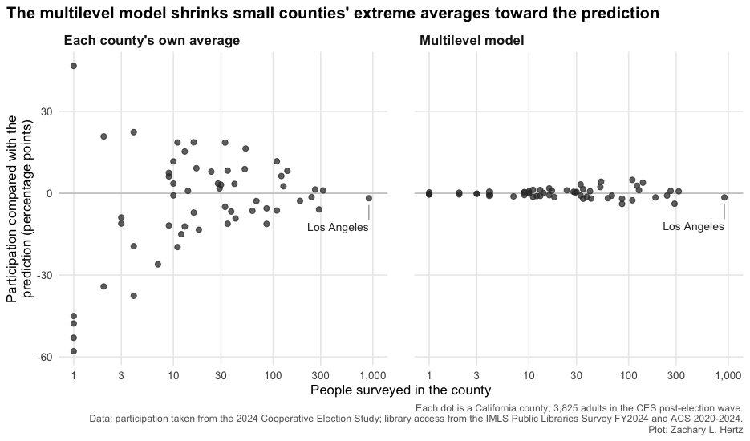
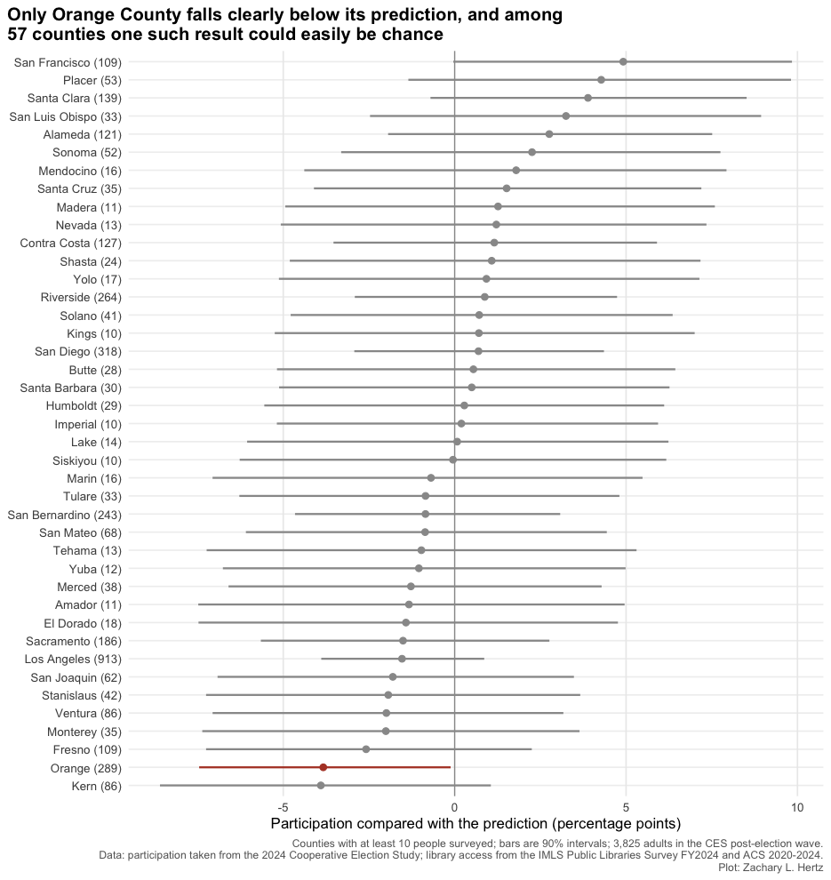

<!-- validation-mlm.Rmd is generated from validation-mlm.Rmd.orig by
vignettes/precompute.R, which needs the network, a Census API key and a local
copy of the CES 2024 Common Content (path in the environment variable
CES_2024_PATH). Edit the .orig file, not the .Rmd. -->


An index of civic opportunity is only useful if it predicts what people do.
This vignette shows one way to check that. It links survey respondents to an
area score, asks whether the score predicts civic participation, and then
looks for the places where the prediction is furthest off. The two steps
follow a common validation design: first, a model that links each
respondent's area score to participation and tests whether access to a
"civic home" changes that link; second, how far each place sits above or
below that model's prediction, used to flag communities the index
mispredicts.

This is a demonstration of method on public data. The area score, the
survey and the moderator are all stand-ins, and the results are not
findings about California.


``` r
library(placeindex)
library(dplyr)
library(ggplot2)
library(sf)
options(tigris_use_cache = TRUE)
```

## The area score: library access by county

The area score is young adults' access to public libraries, from
`vignette("library-access")`. That vignette scores every California tract
with the enhanced two-step floating catchment area method (E2SFCA). E2SFCA
credits a tract with the capacity of libraries within reach, discounted by
distance, and divides each library's capacity among everyone who could use
it. Capacity is annual public service hours, demand is residents aged 18 to
29, and the catchment is 10 km. The code below repeats those steps without
the commentary.


``` r
pls_url <- "https://www.imls.gov/sites/default/files/2026-06/pls_fy2024_csv.zip"
pls_zip <- file.path(tempdir(), basename(pls_url))
download.file(pls_url, pls_zip, mode = "wb", quiet = TRUE)
libraries <- read.csv(unz(pls_zip, "CSV/pls_fy24_outlet_pud24i.csv")) |>
  filter(STABR == "CA", C_OUT_TY %in% c("CE", "BR"), HOURS > 0) |>
  transmute(outlet = paste(FSCSKEY, FSCS_SEQ, sep = "-"), hours = HOURS,
            LONGITUD, LATITUDE) |>
  st_as_sf(coords = c("LONGITUD", "LATITUDE"), crs = 4326) |>
  st_transform(3310)

youth <- tidycensus::get_acs(
  geography = "tract",
  variables = sprintf("B01001_%03d", c(7:11, 31:35)),
  state = "CA", year = 2024, survey = "acs5"
) |>
  group_by(tract = GEOID) |>
  summarise(youth = sum(estimate))

blocks <- tigris::blocks("CA", year = 2020, progress_bar = FALSE) |>
  st_drop_geometry() |>
  transmute(tract = substr(GEOID20, 1, 11), pop = POP20,
            lon = as.numeric(INTPTLON20), lat = as.numeric(INTPTLAT20)) |>
  st_as_sf(coords = c("lon", "lat"), crs = 4269) |>
  st_transform(3310)
demand <- acc_centroids(blocks, tract, pop) |>
  inner_join(youth, by = "tract", relationship = "one-to-one")
demand_df <- st_drop_geometry(demand)

costs <- acc_cost_matrix(demand, libraries, tract, outlet, max_cost = 10000)
tract_access <- acc_e2sfca(demand_df, libraries, costs, tract, youth,
                           outlet, hours, catchment = 10000) |>
  mutate(hours_per_1k = 1000 * access) |>
  left_join(select(demand_df, tract, youth), by = "tract",
            relationship = "one-to-one")
nrow(tract_access)
#> [1] 9129
```

The validation design links each respondent to the score of their own
tract. The survey used here, the Cooperative Election Study (CES), reports
only the respondent's county. So the tract scores are rolled up to counties
with `val_aggregate()`, as a mean weighted by each tract's residents aged 18
to 29. A county score averages over tracts with very different access, so
this link is much coarser than a tract link. With tract identifiers the same
model runs on the tract scores directly and `val_aggregate()` is not needed.


``` r
county_access <- tract_access |>
  mutate(county = substr(tract, 1, 5)) |>
  val_aggregate(county, hours_per_1k, youth)
youth_mean <- weighted.mean(county_access$hours_per_1k, county_access$youth)
youth_sd <- sqrt(weighted.mean((county_access$hours_per_1k - youth_mean)^2,
                               county_access$youth))
county_access <- county_access |>
  mutate(access_z = (hours_per_1k - youth_mean) / youth_sd)
summary(county_access$hours_per_1k)
#>    Min. 1st Qu.  Median    Mean 3rd Qu.    Max. 
#>     0.0   296.7   453.9   769.0   954.7  3889.2
c(youth_mean = youth_mean, youth_sd = youth_sd)
#> youth_mean   youth_sd 
#>   357.6981   163.8541
filter(county_access, hours_per_1k == 0)
#> # A tibble: 1 × 5
#>   county hours_per_1k youth n_units access_z
#>   <chr>         <dbl> <dbl>   <int>    <dbl>
#> 1 06091             0   271       1    -2.18
```

County scores are skewed: the median county scores
454 hours per 1,000 young adults and
the highest 3,889. The high scores belong
to rural counties with few young adults, while most young Californians, and
most survey respondents, live in large counties with scores near the median.
So the score is standardized across young Californians rather than across
counties: each county counts in proportion to its residents aged 18 to 29.
An `access_z` of 0 is the access of the average young Californian,
358 hours, and one unit is one standard deviation of that
distribution, 164 hours. Standardizing across counties
instead would put 0 far from where respondents live, and the model's main
effects would describe a county with almost no respondents.
1 county has no library outlet with
reported hours within 10 km of any of its tracts and scores zero.

## The survey: CES 2024

The CES 2024 Common Content is a national online survey of 60,000 adults,
interviewed before the November 2024 election and again after it. It is
free from the CES Harvard Dataverse. This vignette reads only the columns it
needs from the CSV release, whose path is set in the environment variable
`CES_2024_PATH`. Every variable name and code below was checked against the
CES 2024 guide and against the counts it tabulates.


``` r
ces_vars <- c("inputstate", "countyfips", "birthyr", "gender4", "educ",
              "race", "pew_churatd", sprintf("CC24_430a_%d", 1:8))
ces <- data.table::fread(Sys.getenv("CES_2024_PATH"), select = ces_vars) |>
  as_tibble()
ca <- filter(ces, inputstate == 6)
c(california = nrow(ca), post_wave = sum(!is.na(ca$CC24_430a_1)))
#> california  post_wave 
#>       4900       3873
```

The participation items are in the post-election wave, so only respondents
who took it can be used. The question (`CC24_430a`) asks: "During the past
year did you ... (Check all that apply)". Items 1 to 6 are political or civic
acts: attend local political meetings, put up a political sign, work for a
candidate or campaign, attend a political protest, march or demonstration,
contact a public official, and donate money to a candidate, campaign or
political organization. Item 7 (donate blood) is left out because it is not
political, and item 8 is "none of these". Each item is coded 1 if selected
and 2 if not.


``` r
ca |>
  filter(!is.na(CC24_430a_1)) |>
  mutate(age_18_29 = 2024 - birthyr <= 29) |>
  summarise(respondents = n(), counties = n_distinct(countyfips),
            .by = age_18_29)
#> # A tibble: 2 × 3
#>   age_18_29 respondents counties
#>   <lgl>           <int>    <int>
#> 1 TRUE              371       37
#> 2 FALSE            3502       58
```

The population of interest is adults aged 18 to 29, but only
371 California
respondents in that age group took the post-election wave, too few to
estimate a county-level slope and an interaction. The model therefore uses
all California adults in the post-election wave and lets the access slope
differ for those aged 18 to 29.


``` r
acts <- sprintf("CC24_430a_%d", 1:6)
respondents <- ca |>
  filter(!is.na(CC24_430a_1)) |>
  mutate(
    county = if_else(is.na(countyfips), NA, sprintf("%05d", countyfips)),
    age = 2024 - birthyr,
    age_group = cut(age, c(17, 29, 44, 64, Inf),
                    labels = c("18-29", "30-44", "45-64", "65+")),
    young = as.integer(age_group == "18-29"),
    n_acts = rowSums(pick(all_of(acts)) == 1),
    any_act = as.integer(n_acts > 0),
    monthly = case_when(pew_churatd %in% 1:3 ~ 1L,
                        pew_churatd %in% 4:6 ~ 0L),
    woman = as.integer(gender4 == 2),
    college = as.integer(educ %in% 5:6),
    race = factor(
      case_when(race == 1 ~ "White", race == 2 ~ "Black",
                race == 3 ~ "Hispanic", race == 4 ~ "Asian",
                .default = "Other"),
      levels = c("White", "Hispanic", "Asian", "Black", "Other")
    )
  )
n_dont_know <- sum(is.na(respondents$monthly))
n_no_county <- sum(is.na(respondents$county))

model_data <- respondents |>
  filter(!is.na(monthly), !is.na(county)) |>
  inner_join(select(county_access, county, hours_per_1k, access_z),
             by = "county", relationship = "many-to-one")
county_n <- count(model_data, county)
# Counties with no respondents in the model.
setdiff(county_access$county, county_n$county)
#> [1] "06003"
c(
  respondents = nrow(model_data),
  aged_18_29 = sum(model_data$young),
  counties = nrow(county_n),
  counties_under_10 = sum(county_n$n < 10),
  median_per_county = median(county_n$n),
  any_act = mean(model_data$any_act),
  monthly = mean(model_data$monthly)
)
#>       respondents        aged_18_29          counties counties_under_10 median_per_county 
#>      3825.0000000       362.0000000        57.0000000        16.0000000        18.0000000 
#>           any_act           monthly 
#>         0.4332026         0.2250980
```

The outcome `any_act` is 1 if the respondent did at least one of the six
acts in the past year. `n_acts` counts them, from 0 to 6.

The moderator stands in for a "civic home": an institution that brings
people into civic life. Here it is regular attendance at religious services,
from `pew_churatd` ("Aside from weddings and funerals, how often do you
attend religious services?"). Codes 1 to 3 (more than once a week, once a
week, once or twice a month) count as attending at least monthly, and codes
4 to 6 (a few times a year, seldom, never) do not. The
47 respondents who answered "don't know" (code 7) are dropped.
1 respondent with no county
code is dropped too. Regular attendance is a
proxy for a civic home. A congregation is one kind of civic home, and many young
adults who have one would not find it in a church.

Controls are kept minimal: age group, gender (`gender4` = 2 is a woman), a
four-year degree or more (`educ` 5 or 6) and race (`race` 1 White, 2 Black,
3 Hispanic, 4 Asian, other codes grouped).

## Step 1: does the area score predict participation?

A multilevel model is a regression whose observations are grouped, here
respondents within counties, and which estimates how much the groups
differ. Each county gets a random intercept: its own baseline level of
participation, treated as a draw from a normal distribution whose spread the
model estimates. This lets the model separate what the county score explains
from other differences between counties, and it gives honest standard
errors for a score that varies only between counties.

The model is a logistic regression with a random intercept for each county.
The terms of interest are `access_z`, the standardized county library score;
`access_z:monthly`, which asks whether the link between access and
participation differs for regular attenders; and `access_z:young`, which
lets the access slope differ for adults aged 18 to 29.


``` r
fit <- lme4::glmer(
  any_act ~ access_z * monthly + access_z:young + age_group + woman +
    college + race + (1 | county),
  data = model_data, family = binomial,
  control = lme4::glmerControl(optimizer = "bobyqa")
)
coef_table <- function(fit) {
  s <- summary(fit)$coefficients
  tibble(term = rownames(s), estimate = s[, 1], std_error = s[, 2],
         p_value = s[, 4])
}
coefs <- coef_table(fit)
knitr::kable(coefs, digits = 3)
```


|term             | estimate| std_error| p_value|
|:----------------|--------:|---------:|-------:|
|(Intercept)      |   -0.841|     0.139|   0.000|
|access_z         |    0.042|     0.032|   0.188|
|monthly          |    0.150|     0.082|   0.067|
|age_group30-44   |    0.041|     0.140|   0.772|
|age_group45-64   |    0.284|     0.130|   0.028|
|age_group65+     |    0.821|     0.133|   0.000|
|woman            |   -0.089|     0.069|   0.197|
|college          |    0.760|     0.072|   0.000|
|raceHispanic     |   -0.354|     0.104|   0.001|
|raceAsian        |   -0.739|     0.122|   0.000|
|raceBlack        |   -0.289|     0.139|   0.037|
|raceOther        |    0.106|     0.121|   0.379|
|access_z:monthly |   -0.042|     0.078|   0.596|
|access_z:young   |   -0.024|     0.145|   0.869|


``` r
county_sd <- sqrt(lme4::VarCorr(fit)$county[1, 1])
county_sd
#> [1] 0.167123
```


Estimates are on the log-odds scale, with standard errors and p-values from
the model's Wald tests. The access slope for adults aged 30 and over who do
not attend monthly is 0.042 (SE 0.032, p = 0.19). The interaction with
monthly attendance is -0.042 (SE 0.078, p = 0.60), and the extra
slope for adults aged 18 to 29 is -0.024 (SE 0.145, p = 0.87). The
standard deviation of the county intercepts is 0.17 on the
log-odds scale.

**Power.** The minimum detectable effect (MDE) is the smallest true effect a
study would detect with 80 percent probability in a two-sided test at the 5
percent level. It is about 2.8 times the standard error. For the interaction
it is 2.8 x 0.078 = 0.22 in log odds, an odds ratio
of 1.25 per standard deviation of county access. At the
sample's participation rate of 43 percent, that is
roughly 5 percentage points. A null here would rule out
only interactions about that large. A county-average library score probably
changes the gap between attenders and others by less than that, so a null
would say little. The sample is 3,825
respondents in 57 counties, against more than 85,000
respondents linked by tract in the planned validation.

**Survey weights.** The model does not use the CES weights. In a multilevel
model, weights have to be split and rescaled by level, and lme4's `weights`
argument treats them as precision or trial counts rather than sampling
weights, so passing them would misstate the standard errors. The model
instead conditions on age, gender, education and race, the main variables
the weights adjust for.

The count version uses the same terms with a Poisson model for `n_acts`:


``` r
fit_count <- lme4::glmer(
  n_acts ~ access_z * monthly + access_z:young + age_group + woman +
    college + race + (1 | county),
  data = model_data, family = poisson,
  control = lme4::glmerControl(optimizer = "bobyqa")
)
count_coefs <- coef_table(fit_count)
knitr::kable(count_coefs, digits = 3)
```


|term             | estimate| std_error| p_value|
|:----------------|--------:|---------:|-------:|
|(Intercept)      |   -0.627|     0.087|   0.000|
|access_z         |    0.028|     0.018|   0.128|
|monthly          |    0.101|     0.044|   0.023|
|age_group30-44   |   -0.029|     0.082|   0.725|
|age_group45-64   |    0.095|     0.076|   0.207|
|age_group65+     |    0.352|     0.076|   0.000|
|woman            |   -0.033|     0.038|   0.393|
|college          |    0.537|     0.039|   0.000|
|raceHispanic     |   -0.248|     0.062|   0.000|
|raceAsian        |   -0.676|     0.077|   0.000|
|raceBlack        |   -0.317|     0.084|   0.000|
|raceOther        |    0.048|     0.063|   0.438|
|access_z:monthly |   -0.038|     0.042|   0.371|
|access_z:young   |    0.077|     0.072|   0.284|


The count model's interaction is -0.038 (SE 0.042, p = 0.37)
on the log scale.

## Step 2: which counties does the model mispredict?

The model also gives each county its own estimate: how much more or less
its residents take part than the rest of the model predicts from their
library access, age, gender, education and race. In the model this is the
county's random intercept. `val_group_effects()` returns each county's
estimate with its standard error and a 90 percent interval, and flags
counties whose interval excludes zero. Printed tables in this vignette show
only counties with at least 10 people surveyed, so that no row reports the
answers of one or a few people.


``` r
effects <- val_group_effects(fit, county, level = 0.9)
ca_counties <- tigris::counties("CA", cb = TRUE, year = 2020,
                                progress_bar = FALSE) |>
  st_transform(3310) |>
  select(county = GEOID, name = NAME)
effects <- effects |>
  left_join(st_drop_geometry(ca_counties), by = "county",
            relationship = "one-to-one")
n_flagged <- sum(effects$excludes_zero)
n_flagged
#> [1] 1
printable <- filter(effects, n >= 10)
bind_rows(head(printable, 5), tail(printable, 5)) |>
  select(name, n, estimate, std_error, lower, upper, excludes_zero)
#> # A tibble: 10 × 7
#>    name                n estimate std_error    lower    upper excludes_zero
#>    <chr>           <int>    <dbl>     <dbl>    <dbl>    <dbl> <lgl>        
#>  1 San Francisco     109   0.208     0.127  -0.00170  0.418   FALSE        
#>  2 Placer             53   0.180     0.144  -0.0567   0.416   FALSE        
#>  3 Santa Clara       139   0.169     0.121  -0.0309   0.368   FALSE        
#>  4 San Luis Obispo    33   0.142     0.152  -0.108    0.391   FALSE        
#>  5 Alameda           121   0.121     0.125  -0.0856   0.327   FALSE        
#>  6 Stanislaus         42  -0.0858    0.149  -0.330    0.159   FALSE        
#>  7 Monterey           35  -0.0898    0.152  -0.339    0.159   FALSE        
#>  8 Fresno            109  -0.114     0.129  -0.326    0.0979  FALSE        
#>  9 Orange            289  -0.169     0.0997 -0.333   -0.00514 TRUE         
#> 10 Kern               86  -0.176     0.135  -0.399    0.0466  FALSE
```

The model's county estimates are pulled toward zero, more strongly when a
county has few respondents. This is called shrinkage. A county with three
respondents can have a participation rate 30 points above the prediction by
chance alone. Shrinkage weighs that against how much counties differ in
general, and keeps such a county from being flagged because of noise.

A county estimate is on the model's log-odds scale. To express it in
percentage points, the vignette adds it to the predicted log odds of each
respondent in the county, converts both to probabilities, and averages the
difference over the county's respondents.

Each dot in the figure below is one county, placed by how many people were
surveyed there. The left panel shows the county's own average: the share of
its respondents who took part, minus the share the model predicts for people
with their age, gender, education, race and library access. The right panel
shows the multilevel model's estimate for the same county, which leans on
the statewide pattern when few people were surveyed, so the counties that
look extreme on the left are pulled back to near zero on the right.


``` r
model_data <- model_data |>
  mutate(eta_fixed = predict(fit, re.form = NA),
         p_fixed = predict(fit, type = "response", re.form = NA),
         p_full = fitted(fit))
compare <- model_data |>
  summarise(n = n(),
            own_average = 100 * mean(any_act - p_fixed),
            model_estimate = 100 * mean(p_full - p_fixed),
            .by = county) |>
  left_join(st_drop_geometry(ca_counties), by = "county",
            relationship = "one-to-one")
small <- filter(compare, n < 10)
# The three counties (of those with 10 or more respondents) where the model
# moves the estimate most.
compare |>
  filter(n >= 10) |>
  slice_max(abs(own_average - model_estimate), n = 3) |>
  select(name, n, own_average, model_estimate)
#> # A tibble: 3 × 4
#>   name          n own_average model_estimate
#>   <chr>     <int>       <dbl>          <dbl>
#> 1 Amador       11       -19.7          -1.33
#> 2 Madera       11        18.7           1.27
#> 3 Mendocino    16        18.7           1.79

fig_caption <- function(first_line) {
  paste(first_line,
        paste("Data: participation taken from the 2024 Cooperative Election",
              "Study; library access from the IMLS Public Libraries Survey",
              "FY2024 and ACS 2020-2024."),
        "Plot: Zachary L. Hertz", sep = "\n")
}
fig_theme <- theme_minimal(base_size = 11) +
  theme(panel.grid.minor = element_blank(),
        plot.title = element_text(face = "bold"),
        plot.title.position = "plot",
        plot.caption = element_text(hjust = 1, color = "gray40", size = 8),
        plot.caption.position = "plot")
panel_names <- c("Each county's own average", "Multilevel model")
panels <- bind_rows(
  mutate(compare, panel = panel_names[1], value = own_average),
  mutate(compare, panel = panel_names[2], value = model_estimate)
) |>
  mutate(panel = factor(panel, levels = panel_names))

ggplot(panels, aes(n, value)) +
  geom_hline(yintercept = 0, color = "gray75", linewidth = 0.4) +
  geom_point(color = "gray20", size = 1.8, alpha = 0.75) +
  geom_segment(data = filter(panels, n == max(n)),
               aes(xend = n, y = value - 2.5, yend = value - 8),
               color = "gray50", linewidth = 0.3) +
  geom_text(data = filter(panels, n == max(n)), aes(y = value - 9,
                                                    label = name),
            vjust = 1, hjust = 1, size = 3.2, color = "gray20") +
  facet_wrap(vars(panel)) +
  scale_x_log10(breaks = c(1, 3, 10, 30, 100, 300, 1000),
                labels = c("1", "3", "10", "30", "100", "300", "1,000"),
                limits = c(1, 1000)) +
  labs(
    title = paste("The multilevel model shrinks small counties' extreme",
                  "averages toward the prediction"),
    x = "People surveyed in the county",
    y = "Participation compared with the\nprediction (percentage points)",
    caption = fig_caption(paste0(
      "Each dot is a California county; ", fmt(nrow(model_data)),
      " adults in the CES post-election wave."))
  ) +
  fig_theme +
  theme(strip.text = element_text(hjust = 0, face = "bold", size = 11),
        panel.spacing.x = unit(1.5, "lines"))
```



In the 16 counties with fewer than 10 people surveyed, the own
averages run from -58 to
47 points, while the model's estimates for the
same counties stay between -1.2 and
0.6 points.


``` r
to_points <- function(b, eta) 100 * mean(plogis(eta + b) - plogis(eta))
ranking <- model_data |>
  select(county, eta_fixed) |>
  inner_join(select(effects, county, name, n, estimate, lower, upper,
                    excludes_zero),
             by = "county", relationship = "many-to-one") |>
  summarise(across(c(estimate, lower, upper), \(b) to_points(b, eta_fixed)),
            .by = c(county, name, n, excludes_zero))
n_hidden <- sum(ranking$n < 10)
flagged <- filter(ranking, excludes_zero)
```

The next figure ranks the counties by the model's estimate, in percentage
points. Each dot is a county's estimate and each bar is its 90 percent
interval, and a county counts as clearly above or below its prediction only
when its whole bar sits on one side of zero. A county with few people
surveyed has a wide bar that crosses zero, so the data cannot tell it apart
from its prediction however far its dot sits from zero. The
16 counties with fewer than 10 people surveyed are left out of the
figure because their bars are wide and their estimates sit near zero;
none of them is flagged.
Alpine County has no respondents and is not in the model.


``` r
shown <- ranking |>
  filter(n >= 10) |>
  mutate(label = reorder(
    paste0(name, " (", format(n, big.mark = ",", trim = TRUE), ")"),
    estimate
  ))

ggplot(shown, aes(x = estimate, y = label, color = excludes_zero)) +
  geom_vline(xintercept = 0, color = "gray60", linewidth = 0.4) +
  geom_linerange(aes(xmin = lower, xmax = upper), linewidth = 0.7) +
  geom_point(size = 2) +
  scale_color_manual(values = c(`TRUE` = "#b2432f", `FALSE` = "gray60"),
                      guide = "none") +
  labs(
    title = if (nrow(flagged) == 1) {
      paste0("Only ", flagged$name, " County falls clearly ",
             if (flagged$estimate < 0) "below" else "above",
             " its prediction, and among\n", nrow(effects),
             " counties one such result could easily be chance")
    } else {
      paste0(nrow(flagged), " of ", nrow(effects), " counties fall clearly ",
             "above or below their prediction")
    },
    x = "Participation compared with the prediction (percentage points)",
    y = NULL,
    caption = fig_caption(paste0(
      "Counties with at least 10 people surveyed; bars are 90% intervals; ",
      fmt(nrow(model_data)), " adults in the CES post-election wave."))
  ) +
  fig_theme +
  theme(panel.grid.major.y = element_line(color = "gray94"))
```



## What this shows

1 of 57 counties (Orange) is flagged at the 90 percent level.
With 57 counties, a few flags are expected by chance, so a
flag is a reason to look closer, not a finding. The counties that would
anchor site selection in a real validation are the ones that stay flagged
with tract-level scores, the full survey sample and a measured civic home.
The point of this example is the workflow: aggregate a tract score to the
level the survey identifies, fit the multilevel model, report each term
with its uncertainty and power, and rank places by the model's county
estimates rather than by their own raw averages.
